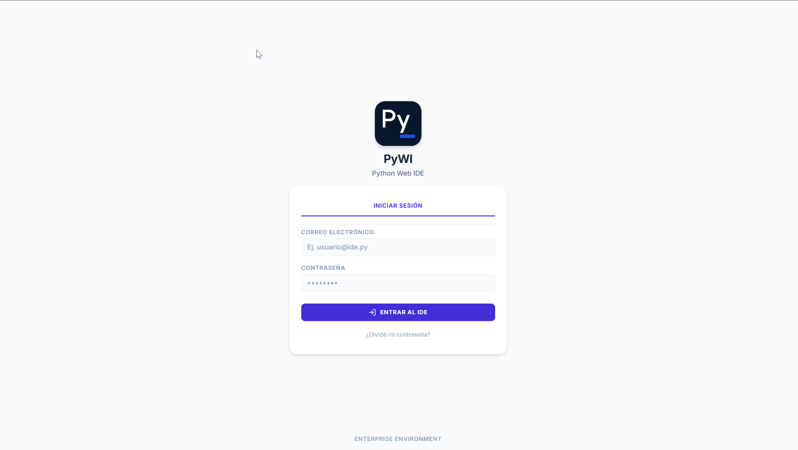
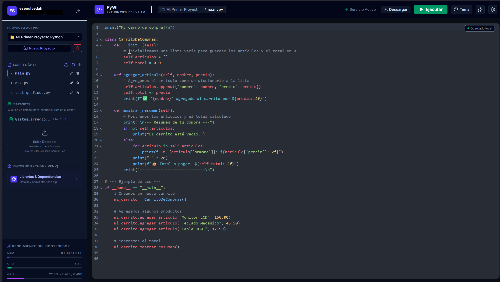
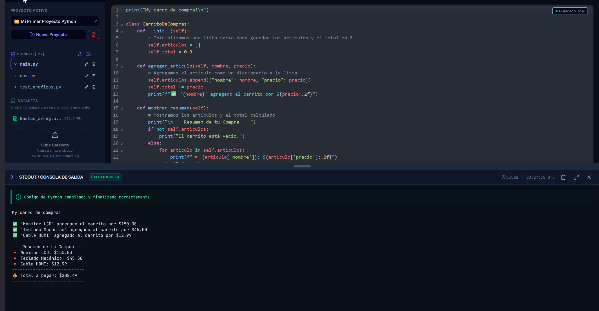
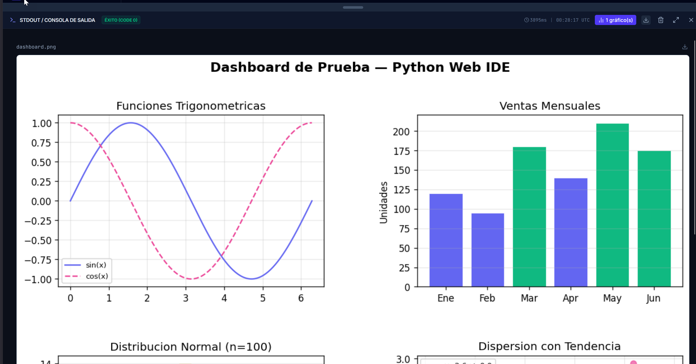

<div align="center">
  

  <h1>PyWI — Python Web IDE</h1>

  <p>
    
    
    
    
    
  </p>

  <p>
    <strong>IDE web Python auto-alojable para estudio y experimentación</strong><br/>
    <em>Self-hosted Python Web IDE for learning and experimentation</em>
  </p>
</div>

---

## ¿Qué es PyWI? / What is PyWI?

**ES:** PyWI es un entorno de desarrollo Python accesible desde el navegador, diseñado para estudiar Python, librerías de datos y machine learning básico. Incluye editor de código, una terminal interactiva real (con soporte para `input()`), visualización de gráficos, gestor de paquetes, visor de datasets, tutor IA integrado y copias de seguridad cifradas con restauración. Funciona completamente desde móvil y es 100% auto-alojable.

**EN:** PyWI is a browser-based Python development environment designed for studying Python, data libraries, and basic machine learning. It includes a code editor, a real interactive terminal (with `input()` support), chart visualization, package manager, dataset viewer, integrated AI tutor, and encrypted backups with restore. Fully mobile-friendly and 100% self-hostable.

---

## Capturas / Screenshots

<div align="center">

| Login | Editor |
|:---:|:---:|
|  |  |
| **Pantalla de inicio de sesión** | **Editor de código Python (dark theme)** |

| Ejecución en vivo | Gráficos matplotlib |
|:---:|:---:|
|  |  |
| **Consola de salida en tiempo real** | **Visualización de gráficos** |

</div>

---

## ¿Para quién es? / Who is it for?

| Perfil / Profile | Descripción / Description |
|---|---|
| 🎓 Estudiantes / Students | Aprende Python y Data Science sin instalar nada localmente / Learn Python and Data Science without installing anything locally |
| 👨‍🏫 Docentes / Teachers | Entorno listo para clases, configurable y auto-alojable / Ready-to-use classroom environment, configurable and self-hostable |
| 🔬 Entusiastas de ML / ML enthusiasts | Experimenta con pandas, sklearn y matplotlib desde el navegador / Experiment with pandas, sklearn and matplotlib from the browser |
| 🏠 Self-hosters | Control total sobre tu entorno de desarrollo Python / Full control over your Python development environment |

---

## Tecnologías / Tech Stack

| Capa / Layer | Tecnologías / Technologies |
|---|---|
| **Frontend** | React 19, Vite, CodeMirror 6, Tailwind CSS, TypeScript |
| **Backend** | Node.js 20, Express, TypeScript, esbuild |
| **Terminal interactiva** | xterm.js, node-pty, WebSocket (soporta `input()` en vivo) |
| **Runtime Python** | Python 3.11, uv, venv, pandas, numpy, matplotlib, seaborn, scikit-learn, openpyxl, xlrd, pyarrow |
| **Tutor IA / AI Tutor** | OpenAI, DeepSeek, Google Gemini, custom (OpenAI-compatible) |
| **Seguridad / Security** | Cookie de sesión HttpOnly, bcryptjs, AES-256-GCM (API keys at rest) |
| **Infraestructura** | Docker, Docker Compose |
| **Hardware soportado** | NVIDIA GPU (amd64), Rockchip RK3588S NPU (arm64) |

---

## Despliegue rápido / Quick Deploy

### Despliegue en un clic / One-click deploy

```bash
curl -fsSL https://raw.githubusercontent.com/esepulvedahgit/pywi/main/deploy.sh | bash
```

El script genera `ENCRYPTION_KEY`, solicita el dominio público, construye la imagen y levanta Docker Compose.
The script generates `ENCRYPTION_KEY`, asks for the public domain, builds the image and starts Docker Compose.

> No configura nginx/TLS — se asume un reverse proxy externo delante del puerto 3000. Para arm64/NPU (Radxa, Orange Pi) o pasos manuales, usa la guía detallada de abajo.
> Does not configure nginx/TLS — an external reverse proxy in front of port 3000 is assumed. For arm64/NPU boards (Radxa, Orange Pi) or manual steps, use the detailed guide below.

### amd64 — PC / Servidor con GPU NVIDIA

```bash
# 1. Obtén el repositorio completo / Get the complete repository
git clone https://github.com/esepulvedahgit/pywi.git
cd pywi

# 2. Configura las variables de entorno / Configure environment variables
cp .env.example .env
# Edita .env con tus valores / Edit .env with your values

# 3. Construye y levanta la aplicación / Build and start the application
docker build -t pywi:local .
docker compose up -d
```

> 💡 La GPU NVIDIA se activa automáticamente si Docker Desktop o nvidia-container-toolkit están configurados.
> The NVIDIA GPU is automatically enabled if Docker Desktop or nvidia-container-toolkit are configured.

Guía detallada → [docs/DEPLOY-AMD64.md](docs/DEPLOY-AMD64.md)

---

### arm64 — Radxa Rock 5A / Orange Pi 5 (NPU RK3588S)

```bash
# Desde el repositorio / From the repository
cp .env.example .env  # configura ENCRYPTION_KEY y APP_URL
docker build -t pywi:local .
docker compose up -d
```

Configuración detallada → [docs/CONFIGURATION.md](docs/CONFIGURATION.md)

---

### Permisos de datos / Data permissions

La imagen se inicia como `node` (UID 1000). El volumen `pywi_data` del Compose incluido funciona sin cambios. Si sustituiste ese volumen por una carpeta del host propiedad de root, prepara sus permisos una vez antes de iniciar la nueva imagen:

The image starts as `node` (UID 1000). The included Compose named volume needs no changes. If you replaced it with a root-owned host directory, prepare its permissions once before starting the new image:

```bash
docker compose stop web-ide
docker compose run --rm --user root web-ide true
docker compose up -d
```

---

## Variables de entorno / Environment Variables

| Variable | Requerida / Required | Descripción / Description | Por defecto / Default |
|---|---|---|---|
| `ENCRYPTION_KEY` | ✅ | Clave AES-256-GCM para cifrar API keys (hex 64 chars) | — |
| `APP_URL` | ✅ | URL pública exacta; usar HTTPS detrás de Sophos / Exact public URL; use HTTPS behind Sophos | `http://localhost:3000` |
| `PYWI_BIND_IP` | ❌ | IP local para el puerto 3000; use la IP privada DMZ si Sophos está en otro host / Local bind IP; use the private DMZ IP for remote Sophos | `127.0.0.1` |
| `TRUSTED_PROXY_IPS` | ❌ | IPs exactas de proxies confiables / Exact trusted proxy IPs | vacío / empty |
| `EXEC_TIMEOUT_MS` | ❌ | Timeout de ejecución Python en ms / Python execution timeout | `180000` |

Generar la clave de cifrado / Generate the encryption key:
```bash
# ENCRYPTION_KEY
node -e "console.log(require('crypto').randomBytes(32).toString('hex'))"
```

Configuración completa → [docs/CONFIGURATION.md](docs/CONFIGURATION.md)
Migración de sesiones y claves antiguas → [docs/security/session-hardening.md](docs/security/session-hardening.md)

---

## Documentación / Documentation

| Documento / Document | Descripción / Description |
|---|---|
| [Funcionalidades / Features](docs/FEATURES.md) | Guía completa de funcionalidades para el usuario final / Complete feature guide for end users |
| [Despliegue amd64](docs/DEPLOY-AMD64.md) | Despliegue detallado con GPU NVIDIA / Detailed deployment with NVIDIA GPU |
| [Despliegue arm64 / NPU](docs/DEPLOY-ARM64.md) | Guía para Radxa 5A, Orange Pi 5 y similares / Guide for Radxa 5A, Orange Pi 5 and similar boards |
| [Configuración avanzada / Advanced Config](docs/CONFIGURATION.md) | Variables de entorno, tutor IA, gestión de usuarios / Environment variables, AI tutor, user management |
| [CI y seguridad / CI and Security](docs/CI-SECURITY.md) | Workflows, alertas de dependencias y configuración de GitHub / Workflows, dependency alerts, and GitHub setup |

---

## Licencia / License

MIT License — libre para uso personal y comercial.
MIT License — free for personal and commercial use.
